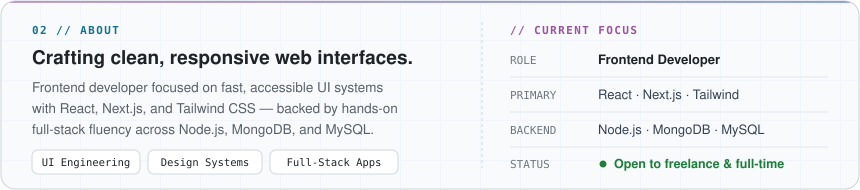
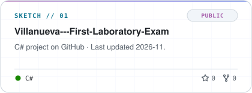
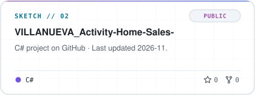
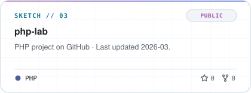
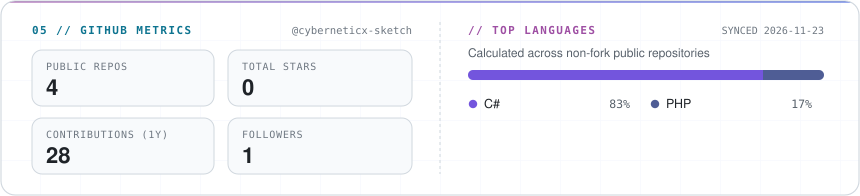
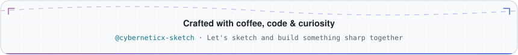

<!-- Cyber-Sketch Aurora GitHub Profile · @cyberneticx-sketch -->

  <picture>
    <source media="(prefers-color-scheme: dark)" srcset="./assets/hero-dark.svg" />
    <source media="(prefers-color-scheme: light)" srcset="./assets/hero-light.svg" />
    
  </picture>

 

  <picture>
    <source media="(prefers-color-scheme: dark)" srcset="./assets/about-dark.svg" />
    <source media="(prefers-color-scheme: light)" srcset="./assets/about-light.svg" />
    
  </picture>

 

  <picture>
    <source media="(prefers-color-scheme: dark)" srcset="./assets/divider-dark.svg" />
    <source media="(prefers-color-scheme: light)" srcset="./assets/divider-light.svg" />
    
  </picture>

<h2 align="center">
  <picture>
    <source media="(prefers-color-scheme: dark)" srcset="./assets/icons/projects-dark.svg" />
    <source media="(prefers-color-scheme: light)" srcset="./assets/icons/projects-light.svg" />
    
  </picture>
  &nbsp;Featured Sketches &amp; Projects
</h2>

<!-- PROJECTS:START -->

  <a href="https://github.com/cyberneticx-sketch/Villanueva---First-Laboratory-Exam">
    <picture>
      <source media="(prefers-color-scheme: dark)" srcset="./assets/generated/project-1-dark.svg" />
      <source media="(prefers-color-scheme: light)" srcset="./assets/generated/project-1-light.svg" />
      
    </picture>
  </a>
  <a href="https://github.com/cyberneticx-sketch/VILLANUEVA_Activity-Home-Sales-">
    <picture>
      <source media="(prefers-color-scheme: dark)" srcset="./assets/generated/project-2-dark.svg" />
      <source media="(prefers-color-scheme: light)" srcset="./assets/generated/project-2-light.svg" />
      
    </picture>
  </a>
  <a href="https://github.com/cyberneticx-sketch/php-lab">
    <picture>
      <source media="(prefers-color-scheme: dark)" srcset="./assets/generated/project-3-dark.svg" />
      <source media="(prefers-color-scheme: light)" srcset="./assets/generated/project-3-light.svg" />
      
    </picture>
  </a>

<!-- PROJECTS:END -->

 

  <picture>
    <source media="(prefers-color-scheme: dark)" srcset="./assets/divider-dark.svg" />
    <source media="(prefers-color-scheme: light)" srcset="./assets/divider-light.svg" />
    
  </picture>

<h2 align="center">
  <picture>
    <source media="(prefers-color-scheme: dark)" srcset="./assets/icons/stack-dark.svg" />
    <source media="(prefers-color-scheme: light)" srcset="./assets/icons/stack-light.svg" />
    
  </picture>
  &nbsp;Digital Arsenal &amp; Tech Stack
</h2>

  
<b>Frontend &amp; Languages</b>

  <picture>
    <source media="(prefers-color-scheme: dark)" srcset="https://skillicons.dev/icons?i=html,css,js,ts,react,nextjs,tailwind&amp;theme=dark&amp;perline=7" />
    <source media="(prefers-color-scheme: light)" srcset="https://skillicons.dev/icons?i=html,css,js,ts,react,nextjs,tailwind&amp;theme=light&amp;perline=7" />
    
  </picture>
  
<code>HTML5</code> · <code>CSS3</code> · <code>JavaScript</code> · <code>TypeScript</code> · <code>React</code> · <code>Next.js</code> · <code>Tailwind CSS</code>

   

  
<b>Backend &amp; Database</b>

  <picture>
    <source media="(prefers-color-scheme: dark)" srcset="https://skillicons.dev/icons?i=nodejs,mongo,mysql,java&amp;theme=dark&amp;perline=4" />
    <source media="(prefers-color-scheme: light)" srcset="https://skillicons.dev/icons?i=nodejs,mongo,mysql,java&amp;theme=light&amp;perline=4" />
    
  </picture>
  
<code>Node.js</code> · <code>MongoDB</code> · <code>MySQL</code> · <code>Java</code>

   

  
<b>Workflow &amp; Tools</b>

  <picture>
    <source media="(prefers-color-scheme: dark)" srcset="https://skillicons.dev/icons?i=linux,figma,vscode,git,github&amp;theme=dark&amp;perline=5" />
    <source media="(prefers-color-scheme: light)" srcset="https://skillicons.dev/icons?i=linux,figma,vscode,git,github&amp;theme=light&amp;perline=5" />
    
  </picture>
  
<code>Linux</code> · <code>Figma</code> · <code>VS Code</code> · <code>Git</code> · <code>GitHub</code>

 

  <picture>
    <source media="(prefers-color-scheme: dark)" srcset="./assets/divider-dark.svg" />
    <source media="(prefers-color-scheme: light)" srcset="./assets/divider-light.svg" />
    
  </picture>

<h2 align="center">
  <picture>
    <source media="(prefers-color-scheme: dark)" srcset="./assets/icons/metrics-dark.svg" />
    <source media="(prefers-color-scheme: light)" srcset="./assets/icons/metrics-light.svg" />
    
  </picture>
  &nbsp;GitHub Activity &amp; Metrics
</h2>

  <a href="https://github.com/cyberneticx-sketch">
    <picture>
      <source media="(prefers-color-scheme: dark)" srcset="./assets/generated/stats-dark.svg" />
      <source media="(prefers-color-scheme: light)" srcset="./assets/generated/stats-light.svg" />
      
    </picture>
  </a>

 

  <picture>
    <source media="(prefers-color-scheme: dark)" srcset="./assets/divider-dark.svg" />
    <source media="(prefers-color-scheme: light)" srcset="./assets/divider-light.svg" />
    
  </picture>

<h2 align="center">
  <picture>
    <source media="(prefers-color-scheme: dark)" srcset="./assets/icons/connect-dark.svg" />
    <source media="(prefers-color-scheme: light)" srcset="./assets/icons/connect-light.svg" />
    
  </picture>
  &nbsp;Let's Connect
</h2>

  
  &nbsp;
  
  <!-- Uncomment and replace URLs below when ready to publish additional contact channels:
  &nbsp;
  
  &nbsp;
  
  &nbsp;
  
  &nbsp;
  
  -->

 

  <picture>
    <source media="(prefers-color-scheme: dark)" srcset="./assets/footer-dark.svg" />
    <source media="(prefers-color-scheme: light)" srcset="./assets/footer-light.svg" />
    
  </picture>

